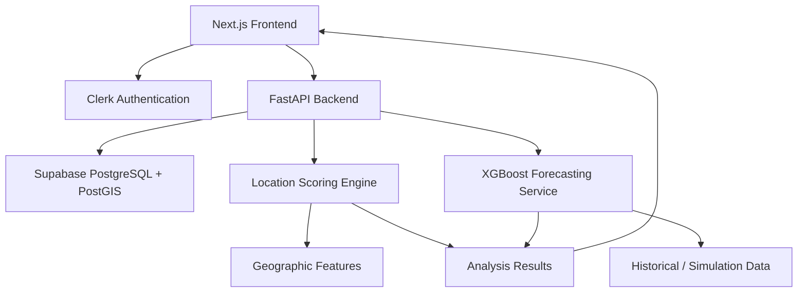

# SiteSuri

**Smarter Locations. Better Business Decisions.**

SiteSuri is a web-based geospatial decision-support platform designed to help Filipino Micro, Small, and Medium Enterprises (MSMEs) evaluate potential business locations through geographic analysis, explainable suitability scoring, and experimental pedestrian activity forecasting.

Rather than relying solely on intuition when choosing a business location, SiteSuri aims to provide entrepreneurs with accessible, location-based insights to support more informed decisions.

**Project:** CSSprint 2026 Hackathon  
**Category:** Geospatial Analytics / Business Intelligence  
**Target Users:** Filipino MSMEs and aspiring entrepreneurs  
**Development Status:** In Development

---

## Problem Statement

Choosing a suitable business location can be challenging for Filipino MSMEs, especially those with limited access to market research and geographic intelligence tools.

Entrepreneurs may need to consider several factors, including nearby competitors, accessibility, surrounding establishments, potential customer activity, and transportation conditions.

SiteSuri aims to bring these indicators together in an interactive platform that makes location analysis more accessible and understandable.

## Proposed Solution

SiteSuri will allow users to search for specific addresses or geographic areas, analyze their surroundings, and review location suitability indicators based on their intended business category.

### Core Features

- **Geographic Location Search:** Search addresses, landmarks, or areas using an interactive map.
- **Proximity Analysis:** Evaluate nearby establishments, competitors, transportation access, and other geographic features within a selected radius.
- **Location Suitability Scoring:** Generate explainable, category-specific location assessments.
- **Activity Forecasting:** Explore experimental pedestrian activity estimates using historical patterns and supervised machine learning.
- **Location Comparison:** Compare candidate locations and understand the factors influencing their scores.
- **User Accounts:** Support authentication and personalized location research.

Feature availability will evolve throughout development.

## Technology Stack

| Component | Technology |
|---|---|
| Frontend | Next.js, React, TypeScript |
| Styling | Tailwind CSS |
| Authentication | Clerk |
| Backend | Python, FastAPI, Pydantic |
| Database | Supabase PostgreSQL |
| Geospatial Processing | PostGIS |
| Map Visualization | MapLibre GL JS (planned) |
| API Communication | Axios, TanStack Query |
| Machine Learning | XGBoost, scikit-learn, pandas |
| Deployment | Vercel / Cloudflare (under evaluation) |
| Version Control | Git and GitHub |

## System Architecture

The proposed application separates the user interface, geographic analysis, and machine learning components.



This diagram represents the intended architecture and does not imply that every service is currently deployed.

## Project Structure

SiteSuri uses a monorepo architecture to organize the frontend, backend, machine learning, and database resources.

```text
sitesuri/
├── apps/
│   ├── web/              # Next.js frontend
│   └── api/              # FastAPI backend
│
├── ml/                   # Dataset processing and ML models
├── supabase/             # Database schemas and migrations
├── docs/                 # Project documentation
└── README.md
```

Some directories are reserved for future implementation and may not yet contain tracked files.

## Development Branches

| Branch | Responsibility |
|---|---|
| `main` | Stable integration and submission branch |
| `feature/frontend` | Frontend, UI/UX, authentication, and mapping |
| `feature/backend` | REST APIs, geographic analysis, and scoring |
| `feature/ml` | Dataset preparation, training, and forecasting |

Completed changes are integrated into `main` after review and testing.

## Local Development

### Prerequisites

- Node.js and npm
- Git
- Python (for backend and ML development)
- Clerk application credentials (for authentication)

### Clone the Repository

```bash
git clone https://github.com/averageCoder-bit/sitesuri.git
cd sitesuri
```

### Run the Frontend

```bash
cd apps/web
npm install
npm run dev
```

Open `http://localhost:3000` in your browser.

Authentication requires valid Clerk environment variables configured in `apps/web/.env.local`.

Never commit `.env.local`, API credentials, private keys, or other secrets.

Backend and ML setup instructions will be added as those components are implemented.

## Data and Machine Learning

SiteSuri's planned scoring approach considers factors such as:

- Pedestrian activity estimates
- Nearby business competition
- Accessibility and transportation
- Road or traffic conditions, when reliable data is available
- Nearby establishments and potential demand generators

The machine learning component is intended to use XGBoost regression to explore time-dependent pedestrian activity patterns.

### Data Transparency

Initial development may use synthetic historical activity records to prototype the forecasting pipeline.

Synthetic data does not represent actual pedestrian measurements, and predictions trained on such records must not be interpreted as validated real-world forecasts.

SiteSuri is a decision-support platform. Its scores do not guarantee profitability, commercial property availability, or permission to operate.

## Development Roadmap

- [x] Initialize GitHub repository and development branches
- [x] Generate Next.js frontend scaffold
- [ ] Complete and integrate frontend authentication
- [ ] Finalize responsive landing page and public demo
- [ ] Implement authenticated dashboard
- [ ] Integrate interactive maps and geocoding
- [ ] Develop FastAPI backend
- [ ] Configure Supabase and PostGIS
- [ ] Implement geographic suitability scoring
- [ ] Prepare and validate historical/synthetic datasets
- [ ] Train and evaluate experimental XGBoost model
- [ ] Integrate forecasting and analytics
- [ ] Conduct end-to-end testing
- [ ] Deploy and finalize the hackathon prototype

## Acknowledgments

Developed as an entry for **CSSprint 2026**, with a focus on practical digital solutions addressing challenges faced by Filipino MSMEs.

---

**SiteSuri** — Helping businesses make more informed location decisions.
